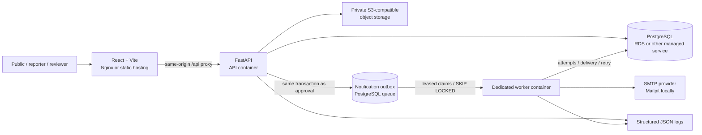

# FindBack architecture

The implementation follows the 18-page project plan. React/Vite is the presentation layer, FastAPI is the application layer, PostgreSQL stores relational records and the durable queue, and a separately deployed worker sends email. Local services need no cloud credentials.

The supplied [AWS deployment](AWS_DEPLOYMENT.md) runs API, worker, and Nginx on EC2
behind an HTTPS ALB with RDS, private S3, and SES. Alternative Vercel/Render/Neon
templates are retained for users choosing those providers.

## Approval and delivery

1. A case is created as PENDING/PRIVATE. The reporter contact is stored separately. No exact coordinate is collected.
2. A reviewer checks every proposed public field, optionally sanitizes descriptions, and explicitly selects whether to publish the photograph and district map point.
3. The backend locks the case, validates its transition, records the decision, and inserts matching recipient jobs in the same database transaction. A unique `(case_id, user_id, channel)` constraint prevents duplicate logical deliveries.
4. The durable database table is both transactional outbox and queue. This equivalent reliable queue avoids an extra PostgreSQL-to-Redis publication failure window. A worker claims due jobs with `FOR UPDATE SKIP LOCKED` and a bounded lease, then commits the claim before SMTP I/O.
5. Success, cancellation or exponential retry is recorded only when the worker still owns its claim token. Expired processing leases can be reclaimed after a crash. Attempts include abandoned claims. Failed jobs are inspectable and can be retried by an administrator.
6. Delivery rechecks publication, status, account activity, subscription and preferences. Hidden/resolved cases and opted-out recipients are cancelled. Synthetic content is cancelled unless the local demo email flag is explicitly enabled.

SMTP provides **at-least-once** delivery, not an exactly-once guarantee. A crash after the provider accepts mail but before the database records success can deliver a duplicate. Stable Message-ID values help downstream deduplication, but an idempotent transactional email API would be required to close that window. No misleading exactly-once claim is made.

## Data and privacy boundaries

- Public case serialization uses a Pydantic allowlist: random reference, approved descriptive fields, date (no exact time), general area, optional approved photo URL and safe district centroid. No ORM object is returned publicly.
- The country code is stored separately. The initial validation/catalog supports all 64 Bangladesh districts. Twelve deliberately coarse district centroids are supplied; other districts appear without markers until a safe centroid is curated.
- `public_area_code` replaces redundant latitude/longitude storage. Coordinates are derived from a server-owned catalog so callers cannot inject precise locations. This deliberate schema refinement enforces the plan's privacy requirement.
- Reporter contacts, sightings, supporting images and review notes require ownership or reviewer permissions. Sightings are never listed in a public API. Reviewer email notifications contain only a generic reference and authenticated workspace link.
- Resolution hides the case and its media. This version does not retain resolved public case pages. Removal concerns enter an audited reviewer queue; reporters can immediately remove their photograph.

## Reliability and scale

Stateless API processes can scale separately from workers. Sessions and rate buckets reside in PostgreSQL and are shared across processes. Add connection pooling appropriate to the managed database limit. Queue scanning uses status/available-at indexes. Scale workers horizontally with leased, locked claims; keep SMTP timeout shorter than the lease.

Database and object storage are independent failure domains. Upload failures before DB commit remove the newly written object. A crash between object write and database commit can still leave an orphan; production operators should reconcile unused objects under a retention policy. Access always checks database visibility, so such orphans have no public route.

Local Docker binds PostgreSQL, SMTP and Mailpit only to loopback. Production startup rejects local storage, insecure cookies, missing TLS/authenticated SMTP, demo email, and the known development database credential.

## Monitoring and backup

`/health` checks process liveness; `/ready` checks a reachable migrated database. JSON logs contain request IDs, method, duration and status, or job IDs, status and attempts. They deliberately omit request bodies, contacts, tokens and query strings. Adapter selection in Admin health is configuration, not a claim of external connectivity.

Alert on error rates, latency, oldest pending job age, failed delivery counts and missing worker activity. Configure provider log retention and external readiness checks. Provider backup policies and an actual restore drill are deployment tasks; see DEPLOYMENT.md.
