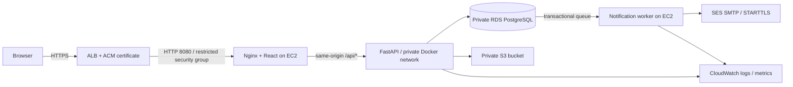

# AWS deployment

FindBack can run on AWS. This guide supplies an EC2 Docker Compose deployment
using RDS PostgreSQL, a private S3 bucket, SES SMTP, an HTTPS Application Load
Balancer (ALB), and CloudWatch. No AWS resources have been provisioned by this
repository. The configuration has local container/integration verification;
AWS acceptance checks remain outstanding.

## Architecture



The PostgreSQL outbox remains the queue; SQS is not required by this implementation.
One EC2 host is suitable for the student demonstration and is a single point of
failure. For higher availability, run API and worker images as separate ECS Fargate
services with RDS and ALB; the same application commands and environment apply.
The supplied Compose file targets EC2 and does not provision ECS resources.

## 1. Provision the AWS prerequisites

Choose one region (the examples use `ap-southeast-1`) and review current AWS costs.
Set a budget alert before creating resources; EC2, RDS, ALB, storage, public IPv4,
logs, and data transfer may incur charges. No free-tier eligibility is assumed.

1. Use a VPC with an ALB in at least two public subnets and RDS in private subnets.
   Configure internet egress for the application host to install images and reach SES/S3.
2. Create an EC2 Linux **x86_64** host with Docker Engine and the Compose plugin.
   Allow host port **8080 only from the ALB security group**. Use Systems Manager
   Session Manager for administration. Do not expose ports 8000, 5432, or SMTP.
3. Create RDS PostgreSQL 17 with encryption, backups, and public access disabled.
   Allow 5432 only from the EC2 application security group. Create a dedicated
   `findback` database/user; URL-encode the password in `DATABASE_URL`.
4. Create a private S3 bucket with Block Public Access and default encryption.
   Attach the narrow policy in `infrastructure/aws/s3-policy.json.example` to
   the EC2 instance role after replacing its bucket placeholder. Configure object
   retention/versioning according to your removal policy. No bucket CORS or public
   ACL is needed because authorized reads/uploads pass through FastAPI.
5. Require IMDSv2 on EC2 and set its response hop limit to **2** so boto3 inside
   Docker can retrieve instance-role credentials. Do not create static S3 keys.
6. Verify an SES sender/domain and configure DKIM and sender DNS. Obtain **SES SMTP
   credentials for the selected region**; these differ from normal AWS access keys.
   Use STARTTLS port **587**. While SES is in its sandbox, verify recipients too;
   request production sending access before sending to unverified addresses.
7. Create an ACM certificate for your domain. Configure ALB HTTPS 443, redirect HTTP
   80 to HTTPS, and forward to the EC2 target on 8080. Use
   `/api/v1/ready` as the target-group health check with success code 200. Point DNS
   to the ALB. Keep its default X-Forwarded-For append behavior.

## 2. Configure the release on EC2

From an authorized shell on EC2:

```bash
git clone https://github.com/Shariar-Joy/FindBack.git
cd FindBack
cp infrastructure/aws/.env.production.example .env.production
chmod 600 .env.production
mkdir -p infrastructure/aws/certs
curl --fail --show-error --location \
  https://truststore.pki.rds.amazonaws.com/global/global-bundle.pem \
  --output infrastructure/aws/certs/rds-ca.pem
```

Edit `.env.production` on the host, replacing **every** placeholder. Set your
exact HTTPS frontend origin in both `FRONTEND_URL` and `ALLOWED_ORIGINS` (no trailing
slash). Set the two dedicated ALB subnet CIDRs in `ALB_TRUSTED_CIDR_1/2`.
Do not use `0.0.0.0/0` or every private subnet as a proxy trust range.

Use RDS's actual endpoint with `sslmode=verify-full` and the mounted CA bundle.
Keep `.env.production` and its database/SMTP secrets outside Git and restrict host
access. Single-quote values containing `$` in the Compose env file to prevent
interpolation. A managed secret-delivery system can materialize this file at
deployment time; the repository does not implement Secrets Manager retrieval.

Nginx replaces forwarded client headers using only the trusted ALB subnets.
The API accepts proxy headers only on its isolated Docker network and has no
published host port. This boundary is necessary for per-client database rate limits.
The production proxy deliberately assumes HTTPS terminated at the ALB; do not
expose the host as an HTTP website.

## 3. Build, migrate, and start

```bash
docker compose --env-file .env.production -f infrastructure/aws/compose.production.yml build
docker compose --env-file .env.production -f infrastructure/aws/compose.production.yml run --rm migrate
docker compose --env-file .env.production -f infrastructure/aws/compose.production.yml up -d api worker frontend
docker compose --env-file .env.production -f infrastructure/aws/compose.production.yml ps
```

Run migrations once per release before starting the new application. A failed
migration must stop the release. Take an RDS snapshot before schema changes and
review backward compatibility. For future releases, check out an explicit commit
or tag and rebuild; set `FINDBACK_RELEASE` to identify image versions if desired.
This single-host flow can require downtime. Do not race migrations across hosts.

Bootstrap the first administrator on a **fresh** database:

```bash
read -r -p 'Admin email: ' BOOTSTRAP_ADMIN_EMAIL
read -r -s -p 'Admin password: ' BOOTSTRAP_ADMIN_PASSWORD
export BOOTSTRAP_ADMIN_EMAIL BOOTSTRAP_ADMIN_PASSWORD
docker compose --env-file .env.production -f infrastructure/aws/compose.production.yml \
  run --rm -e BOOTSTRAP_ADMIN_EMAIL -e BOOTSTRAP_ADMIN_PASSWORD api python -m app.cli bootstrap-admin
unset BOOTSTRAP_ADMIN_EMAIL BOOTSTRAP_ADMIN_PASSWORD
```

Never run the development seed in production. Production disables demo mail and
requires secure cookies, private S3 storage, a real sender, and authenticated TLS SMTP.
For a fictional public demonstration, enter clearly fictional reports manually
and restrict subscriptions to controlled test recipients.

## 4. Verify the actual deployment

- Check HTTPS, certificate, `/api/v1/ready`, SPA deep links, and security headers.
- Register/login/logout through the public domain. Confirm secure HTTP-only session
  cookies, CSRF writes, and distinct client addresses under rate limiting.
- Submit a fictional report and photograph. Confirm pending/public 404, reviewer
  access, approval, private sighting permissions, and public image revocation after hiding/resolution.
- Confirm objects remain private in S3, missing objects return 404, and upload/read/delete
  work using the EC2 role. Exercise SES TLS delivery and queue retry/restart behavior.
- Publish an actual operator support contact and retention policy before real use.

## 5. Monitor, back up, and stop

Install/configure the CloudWatch agent for host metrics and Docker log collection.
The Compose configuration rotates JSON files but does **not** install a CloudWatch
agent. Restrict log access and retention; avoid enabling ALB access logs without
reviewing their request-URL retention because search terms may be sensitive.
Monitor ALB unhealthy targets/5xx, API latency, disk/memory, old pending jobs,
failed jobs, and missing worker progress. Configure alerts to an operator channel.

Enable RDS backups/PITR, restore into a separate private database, run readiness
and privacy smoke tests against the restore, and record the result. Configure S3
retention/deletion for both current objects and historical versions. Removing a
photo from the app does not automatically purge old bucket versions.

`docker compose --env-file .env.production -f infrastructure/aws/compose.production.yml down`
stops application containers. It does **not** delete or stop billable AWS resources.
Review and remove demonstration resources through AWS when no longer needed,
preserving any required backups first.

## Official references

- [ALB routing for ECS/Fargate](https://docs.aws.amazon.com/AmazonECS/latest/developerguide/alb.html)
- [EC2 instance-role metadata and container hop limits](https://docs.aws.amazon.com/AWSEC2/latest/UserGuide/configuring-instance-metadata-options.html)
- [RDS PostgreSQL TLS](https://docs.aws.amazon.com/AmazonRDS/latest/UserGuide/PostgreSQL.Concepts.General.SSL.html)
- [SES SMTP TLS ports](https://docs.aws.amazon.com/ses/latest/dg/smtp-connect.html)
- [SES SMTP credentials](https://docs.aws.amazon.com/ses/latest/dg/smtp-credentials.html)
- [SES sandbox restrictions](https://docs.aws.amazon.com/ses/latest/dg/request-production-access.html)
