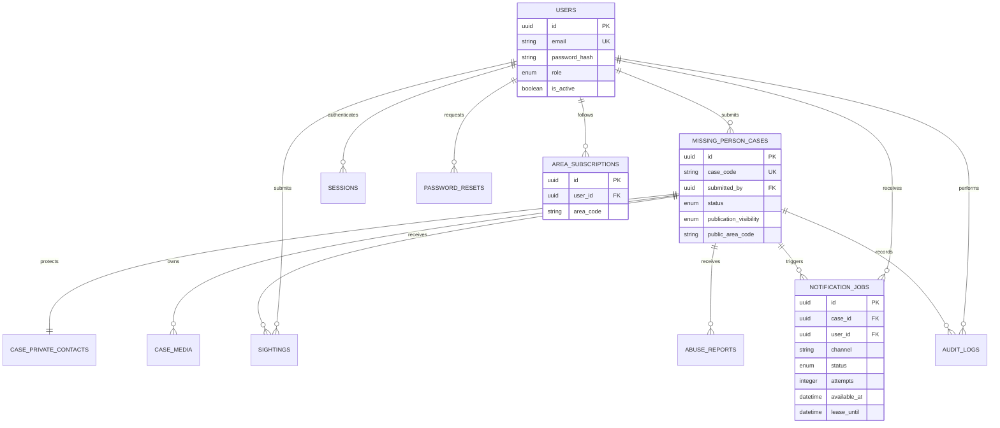

# Database relationships

All record IDs are random UUIDs. Public case references contain 64 random bits and are unrelated to primary keys. PostgreSQL enums constrain role, lifecycle, publication visibility, sighting review status and notification status. Case lifecycle and visibility are independent. A check constraint prevents pending/rejected public records.

`case_private_contacts.case_id` is unique. Subscriptions have a composite user/area unique constraint; notification jobs have a composite case/user/channel unique constraint. Images are object keys, not binary columns. `email_outbox` independently handles reset links and generic private review notifications. `rate_buckets` uses atomic upserts and hashed network buckets.

Foreign keys restrict deleting a case's reporter, cascade dependent case data, cascade user sessions/subscriptions/jobs, and preserve audit records with nullable actor/case references. Accounts are deactivated instead of hard-deleted through the UI. Public access never depends on cascade behavior.

Initial migration: `backend/alembic/versions/9c699a783d3d_initial_schema.py`. Run from `backend`: `python -m alembic upgrade head`. Inspect a proposed migration before deployment. `python -m alembic check` detects metadata drift. Never use `create_all` in production startup; it is reserved for isolated automated test schemas.
